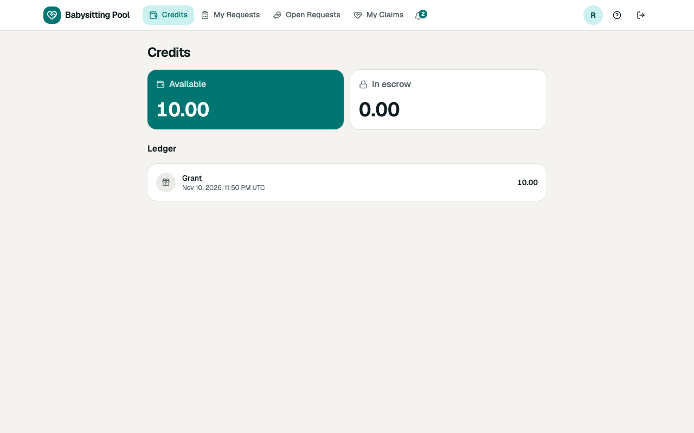
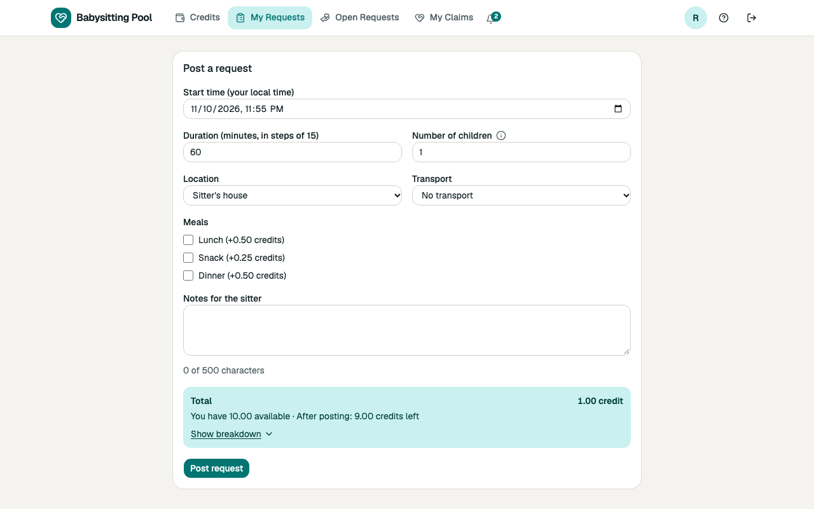
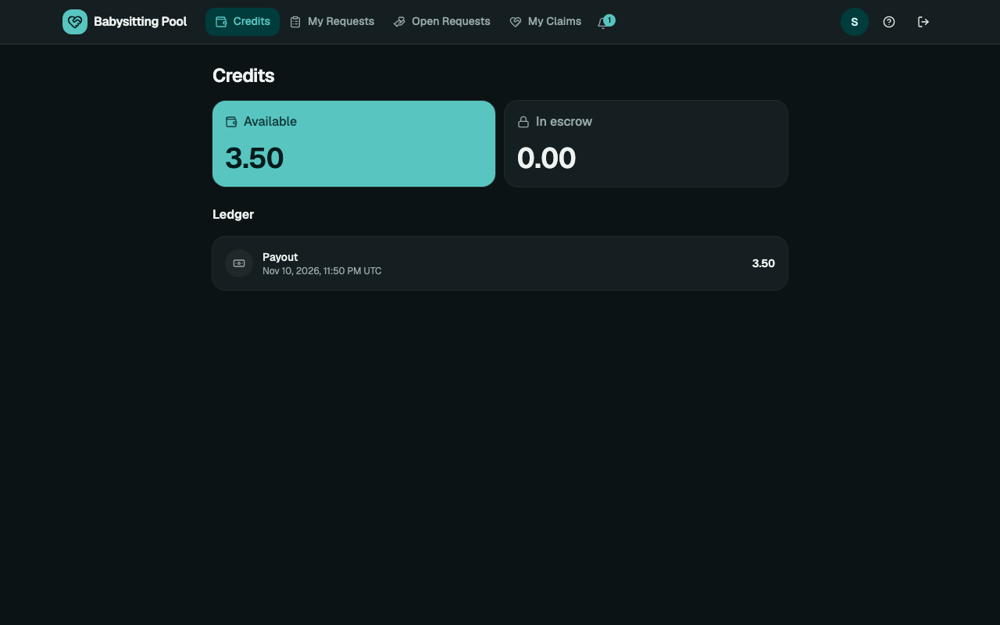
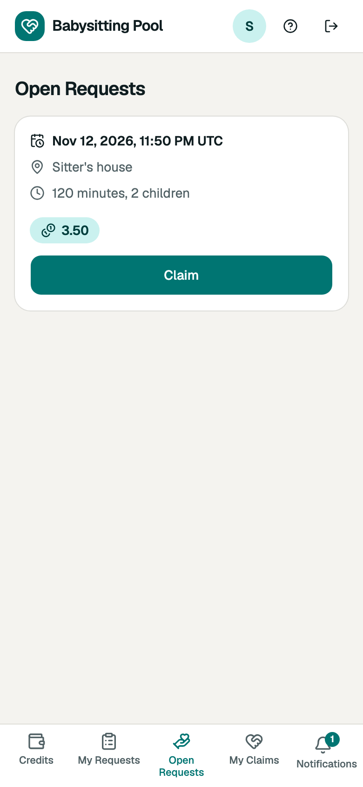
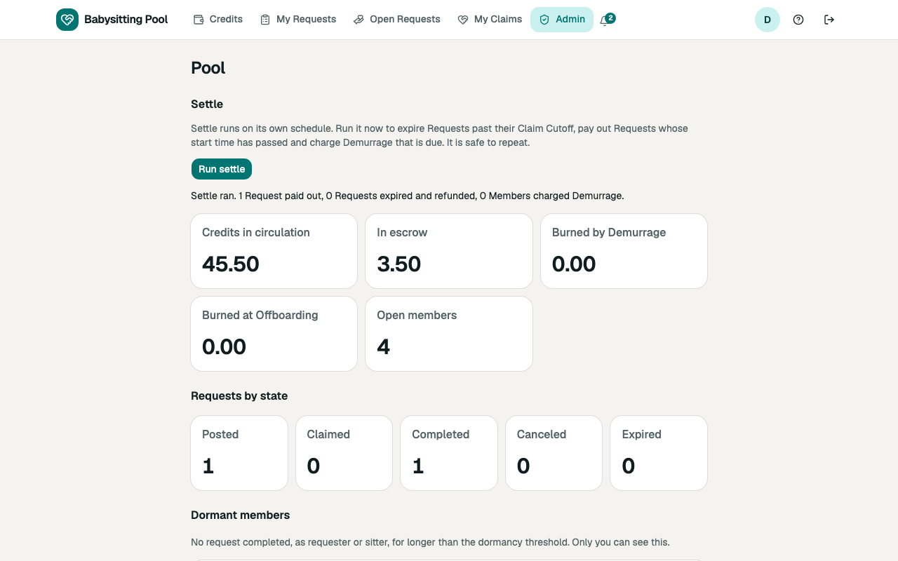
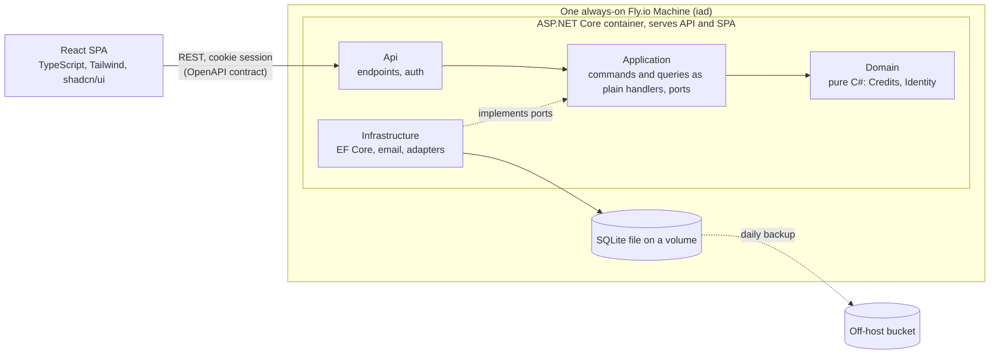

# Babysitting Pool

A web app for a community babysitting co-op, run on time credits instead of money.

## The problem

Neighbors would trade childcare if keeping score were not awkward. Here every [Member](GLOSSARY.md) holds a Credit Account: a [Requester](GLOSSARY.md) pays credits into escrow when posting a [Request](GLOSSARY.md), and the [Sitter](GLOSSARY.md) who claims it is paid out once the babysitting has happened. One hour of standard babysitting is 1.0 credit, and every movement is a Ledger entry that cannot be edited. A new Member starts with 10.0 credits, so a family can ask before it has given, and inactivity slowly drains a balance (Demurrage) so credits keep circulating. The rules are in [docs/specs/credit-engine.md](docs/specs/credit-engine.md); the vocabulary is in the [glossary](GLOSSARY.md).

| Credits and Ledger | Posting a Request |
|---|---|
|  |  |

| Sitter after a payout (dark mode) | Open Requests on a phone |
|---|---|
|  |  |

The Admin runs the co-op with limited powers (no balance edits) and can trigger the time-driven payout and expiry run:



These were taken from the seeded demo ([`scripts/demo-seed.sh`](docs/development.md#demo-seed), walked through in [docs/demo-script.md](docs/demo-script.md)).

## Architecture



- **Hexagonal:** the Domain has no framework or database dependencies and enforces the business invariants (for example the balance floor). Application defines the ports, Infrastructure implements them, and an architecture test fails the build when a layer reaches the wrong way ([tests](src/backend/BabysittingPool.Tests/Architecture)).
- **CQRS without a mediator:** each command or query is its own handler class that endpoints call directly; commands go through domain objects, queries may project straight from the database ([ADR 0002](docs/adr/0002-plain-handlers-no-mediator.md)).
- **SQLite:** one file, one transaction per handler, a concurrency token, tested on real SQLite ([ADR 0004](docs/adr/0004-sqlite-persistence-and-test-strategy.md)). Time-driven changes (expiry, payout, Demurrage) happen in one idempotent Settle run ([ADR 0007](docs/adr/0007-settle-time-driven-processes.md)).
- **Fly.io:** one container, never scaled past one Machine, daily off-host backups ([ADR 0018](docs/adr/0018-deployment-on-fly-io.md)).
- **Frontend:** feature slices with lint-enforced one-way dependencies, a generated API client, react-intl translations ([ADR 0005](docs/adr/0005-frontend-feature-slices.md), [ADR 0006](docs/adr/0006-rest-contract.md), [ADR 0009](docs/adr/0009-react-intl-for-frontend-i18n.md)).

All decisions are indexed in [docs/adr/](docs/adr/README.md).

## How this was built

The code was written by coding agents working from GitHub issues, one ticket at a time, with a human reviewing. Numbers below come from [docs/metrics.md](docs/metrics.md), a snapshot generated on 2026-11-10 by `scripts/delivery-metrics.mjs`; what each one counts, and what it misses, is in [metrics-definitions](docs/metrics-definitions.md).

| What | Value | Source |
|---|---|---|
| Tickets measured | 91 | [rework table](docs/metrics.md#rework-per-ticket) |
| PRs merged | 136, in four weeks (60, 44, 27 and 5 per week) | [throughput](docs/metrics.md#throughput-prs-merged-per-week) |
| Issue opened to merged | median 4.5 hours, p90 4.6 days (n = 90) | [cycle time](docs/metrics.md#cycle-time) |
| PR opened to merged | median 0.1 hours, p90 1.5 hours (n = 136) | [cycle time](docs/metrics.md#cycle-time) |
| Rework | 48 commits pushed after a PR opened and 7 follow-up fix issues, across the 91 tickets | [rework](docs/metrics.md#rework-per-ticket) |

The PR-to-merge time is short because a PR is only opened after the full gate has passed locally, so most rework happens before it and is not counted ([blind spots](docs/metrics-definitions.md)).

What keeps the agents on track:

- **One ticket, one vertical slice, one PR, one context window**, each with a **Read first:** line naming the spec section and ADRs it needs ([ADR 0013](docs/adr/0013-documentation-structure-and-token-economy.md)).
- **[`AGENTS.md`](AGENTS.md) is a router**, at most 60 lines, that points to the doc for the task instead of restating rules. A script checks its length, that every ADR is indexed and that every relative link resolves.
- **A local two-level gate** replaces GitHub CI: a fast one while iterating and a full one (every test, Playwright journeys, diff coverage, security scans) before pushing ([ADR 0015](docs/adr/0015-local-two-level-gate-replaces-github-ci.md)).
- **A review step:** before a PR is opened, a fresh-context reviewer sees only the diff, the ticket and the [review checklist](docs/review-checklist.md).

## Quickstart

Needs the .NET 10 SDK and Node.

```sh
(cd src/frontend && npm ci)
scripts/dev.sh               # API on :5120 and SPA on :5173; sign-in links are logged to the API console
scripts/check.sh all --fast  # the fast gate; use --full before pushing
```

Configuration, real email, the demo seed and the API contract workflow: [docs/development.md](docs/development.md).

## Docs map

| For | Read |
|---|---|
| Business rules | [docs/specs/](docs/specs/credit-engine.md) and the [glossary](GLOSSARY.md) |
| Decisions | [docs/adr/](docs/adr/README.md) |
| Look and feel | [docs/design.md](docs/design.md) |
| Testing | [docs/testing.md](docs/testing.md) |
| Running and deploying | [docs/development.md](docs/development.md) |
| Pitching it | [docs/demo-script.md](docs/demo-script.md) |
| Delivery numbers | [docs/metrics.md](docs/metrics.md) |
| Working with coding agents | [AGENTS.md](AGENTS.md) and [docs/agents/](docs/agents/issue-tracker.md) |
